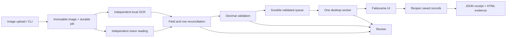

# Image-to-Cash design: a visible order image to verified Fakturama records

## Outcome and boundary

The input is one order image. The output is one saved Fakturama Order and one saved Invoice created through that Order's follow-up action, plus a receipt of the values read back from the saved records. Success requires the source reference, both addresses, every item row, the totals, the payment evidence, the generated identifiers and an open source Order. A plausible editor screenshot is not enough.

The supplied PDF is a requirements document. The sample image was rendered from its page 3, and its hidden text layer is never read. Ingestion accepts raster images only.

## Components

One Python application owns extraction, validation, persistence, orchestration and reporting. The CLI, the localhost API and the desktop worker are separate entry points over one typed adapter interface, and a labelled simulator implements the same interface for tests. Windows controls stay on one COM worker thread. SQLite is a local journal, not a financial database, and the workflow never writes Fakturama's internal storage.

## Control discovery and grounding

Nothing identifies a control by a saved coordinate. Each action resolves its target from the live window:

- **Named controls** use scoped UI Automation lookups by role and label. An input is found from its visible label's position, and an editor is recognized by the field labels it exposes. Win32 calls are used where SWT needs them: native combo selection is what notifies the application, and dates need segment entry.
- **Unlabeled selector icons** (the brief's upper icons beside Addresses and Items) are matched against the icon image in Fakturama's own installed bundle. The best match must score at least 0.95 and beat the runner-up by 0.08, or the run stops.
- **Tables** are NatTable canvases that UI Automation cannot read. Column boundaries come from current header pixels, header text comes from Tesseract, and row values come from a clipboard export whose shape must match those headers. Cell clicks use coordinates computed from the current image. The Items table must expose its nine expected columns. The address picker can copy one row while showing several, so its rows are enumerated by their visible numbers. The user's clipboard text is restored afterwards.
- **Stability:** a selection can change before its repaint, so evidence and reads wait for pixels to settle. Selector dialogs are resized to 95% by 75% of the monitor so that columns are not clipped.

Before work starts, the adapter verifies the workspace in the window title and sets four Fakturama Preferences through the UI: Germany currency locale, cash rounding off, two currency decimals, and unique-item immediate takeover off. These settings persist in the workspace. Unknown layouts and ambiguous controls stop for review. Recorded acceptance covers one display profile, 1920x1200 at 125%.

## Image extraction

OCR and vision read the image independently; the first vision request contains no OCR text. A typed schema preserves identifiers, postcode zeros, repeated SKUs, row order, raw field evidence and decimal strings. Reconciliation tolerates formatting differences, not substitutions such as `O` for `0`.

Acceptance requires complete rows, required values, independent agreement and reconciled arithmetic, because a correct total cannot prove a correct customer, SKU, status or date. One repair pass uses disputed regions with the original image, and any remaining disagreement becomes a specific review. Transport retries are bounded separately. Images are untrusted data, never instructions. RapidOCR is the extraction OCR because it matched 12/12 development documents against Tesseract's 5/12. Cache identities include the image, model, prompt, schema, OCR configuration and preprocessing versions, and a reused reading is marked as reused in the job's evidence.

## Order-first flow

The engine opens New Order first and keeps it open, preserving the generated number while it enters the source date and reference and sets Net and With VAT. The Order's address selector is the Debtor existence check: exactly one row matching Company, First Name, Name, ZIP and City is selected, and conflicting rows stop for review. Only demonstrated absence creates a Debtor, with the Main address as Invoice address, a second address for a different delivery address, the alias, 0% discount and Net pricing. A missing payment method is created inside that branch using the brief's code mapping, leaving the standard method unchanged.

Every source row runs through the Product selector by exact SKU. A missing Product first requires its VAT rate, checked by name, value and E-Invoice code. Its master price is the undiscounted gross, and quantities, net prices, discounts and VAT stay on the document row.

Each line and the totals are verified before Save. After Save, the saved row in Data > Documents must match the document's number, reference, date, state and total, and the document is reopened. The Invoice is created from the saved Order's follow-up action, its generated number and dates are preserved, and only literal `PAID` applies the source date and full gross value. Final verification reopens the source Order, requires it to remain open, and finds both records in the unfiltered This transaction group. The flow creates no Delivery, Correction or Dunning document.

**The reserved email exception.** The official sample's `marta.klein@example.test` uses a reserved domain that Fakturama 2.2.0 will not store. By default the run continues, leaves the source value unchanged, reopens the saved contact to read what actually persisted, and records a typed warning in the receipt and report. It does not claim complete source-field agreement. The exception applies only to a `.test` email. Every other difference still stops, and `ITC_EMAIL_POLICY=strict` restores a stop for this one too.

## Money and recovery

Money uses `Decimal` and an explicit rounding profile: round line net, allocate document adjustments by VAT group, then reconcile printed totals. Five real draft probes matched the half-cent, VAT tie, VAT grouping and document-discount cases. A 30-line document then showed the profile's limit: Fakturama's total matches summing unrounded lines and rounding once, so several sub-cent lines can differ from a source's rounded-line total by a cent. Such a document stops for review before Save; the check is not relaxed. With a document discount, Fakturama's Total Net label remains the pre-discount subtotal, so final net is Total minus VAT and the raw subtotal is retained.

Resume checks generated identifiers against this job's journal and rejects unknown saved Invoice states. Review can reuse an already verified receipt for a duplicate source. The external reference is fixed once Order creation is intended; before that, a correction releases the old reference reservation.

Every consequential action journals its intent first and its observation afterwards. The journal and the UI cannot share a transaction, so recovery inspects real application state and never assumes that an exception means nothing happened. An unsaved follow-up Invoice retains its source Order's editor identity in Fakturama 2.2.0, so recovery reuses the last verified Order checkpoint and reopens that Order after Invoice Save, before success.

OS locks serialize the job, workspace and interactive session. Heartbeats reveal stale workers, but expiry never grants a second writer. A stop after UI work quarantines the session until it is resumed, or until an identified unsaved draft is abandoned with nothing saved. Human corrections keep the original readings and an audit of the resolution.

## Tradeoffs

- **Independent readings over one model call:** this avoids trusting a single reading and has produced no incorrect acceptance so far, but it adds latency, a hosted dependency and false reviews. Two of four harmless image changes stopped for review.
- **Live UI grounding over saved coordinates:** the adapter tolerates layout changes it can observe and stops on the rest, at the cost of speed, a Tesseract dependency, clipboard use and sensitivity to display scale that is still untested.
- **Reading records back over trusting Save:** this caught real defects, including an editor that displays an email the record does not hold. It costs time: reopening the saved contact and verifying the saved relationship took 110 of the 511 desktop seconds in the final official run.
- **Stopping over guessing:** ambiguous or conflicting data never reaches a financial document, but more runs need a person. The email exception is the one deliberate relaxation, and it is flagged rather than hidden.
- **One desktop worker and SQLite over a distributed design:** ownership and recovery stay simple and testable, but throughput is limited to one desktop at a time. PostgreSQL and multiple hosts are extension points, not measured features.

## Evidence and limits

Each run writes the source image, extraction and validation evidence, journal events, screenshots, observed saved values, a JSON receipt with its source hash, and a portable HTML report. Simulation and reviewed replay are labelled. Current results and open items are in the README and the limitations document, so that this design does not carry a second copy of them.

The serialized desktop is the expected throughput limit. Extraction can run concurrently, while each desktop remains single-writer. Measure latency, review and incorrect-acceptance rates, recovery success, verified orders per hour and provider usage before adding services.

## Three additional hours

I would spend the first hour on the measured extraction weaknesses: false reviews for a discount above the item table and for harmless image changes, and automatic backoff in the worker, because Gemini returned HTTP 503 for long stretches during acceptance. I would measure against a fresh held-out set before changing parser or normalization rules.

The second hour would test the desktop outside its one recorded profile: other display scales and window sizes, a lost session, and duplicate or conflicting masters. Failures there would take priority over the third hour.

The third hour would profile row entry, which took about 33 seconds per row and 80% of a 30-line run, then validate one optimization against the same complete workload without weakening any check.
